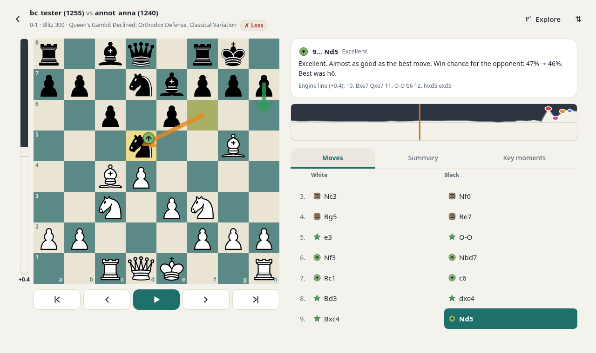
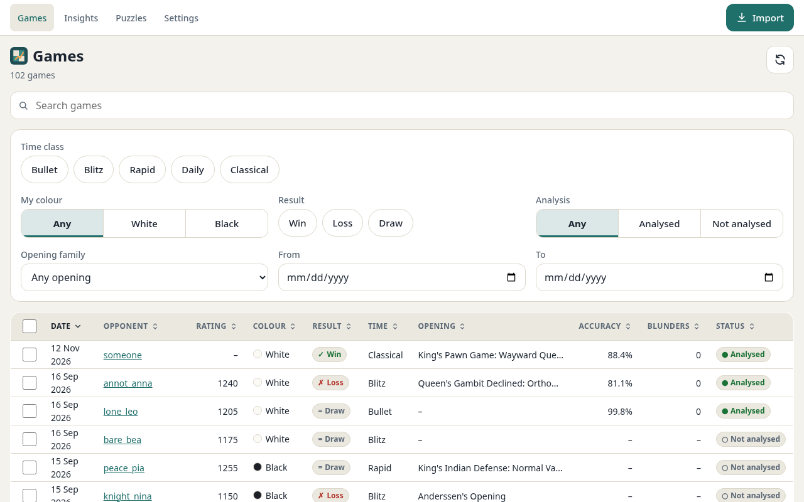
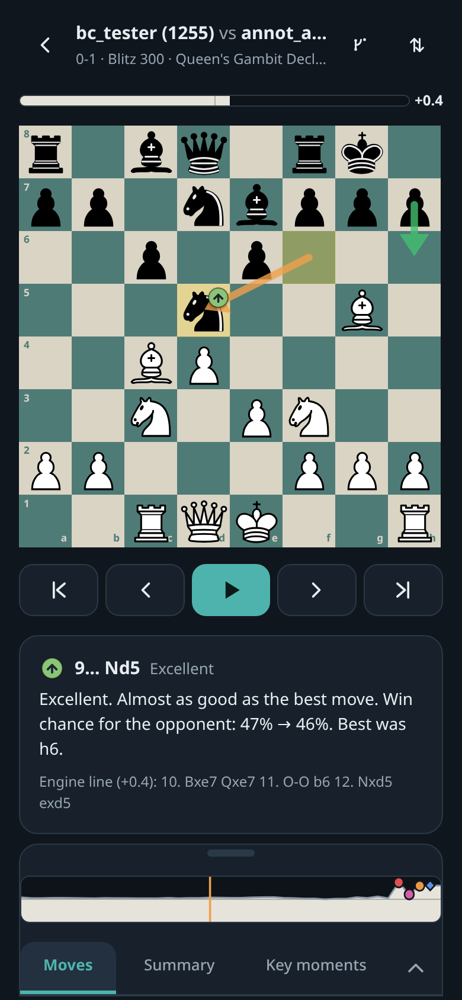
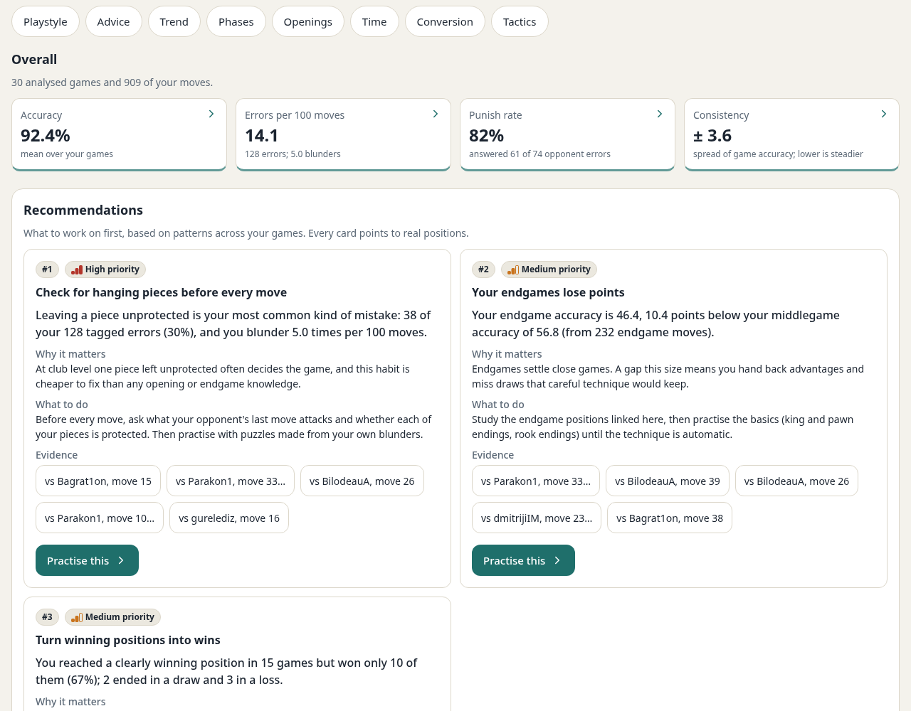
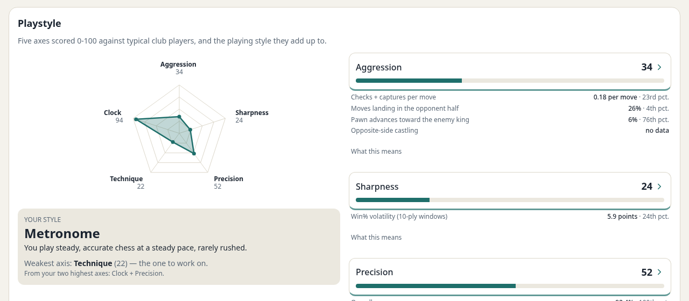
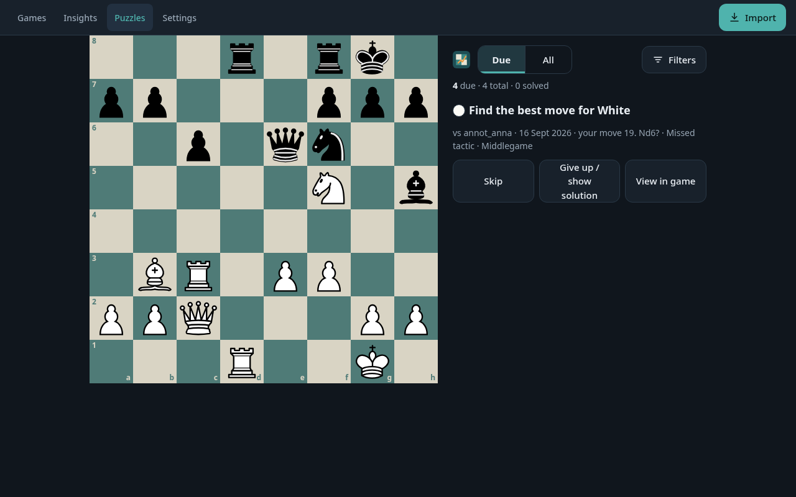

# Chess analyser

> **Built with AI.** This project was written by an AI coding assistant ([Claude Code](https://claude.com/claude-code)),
> working from a written specification and reviewed by a human owner. Every commit made by the assistant
> says so in its message (`by claude code`). Read the code with that in mind, and report anything that
> looks wrong.

A personal chess game analyser that you run yourself. Import your chess.com games, have Stockfish analyse
every move, review each game move by move, see where you win and lose points, and train puzzles made
from your own mistakes.

Everything runs on your own machine. There are no accounts and no cloud sync, and nothing leaves the
machine except requests to chess.com's public API.



## What it does

### Games: import and library

- **Import** games three ways: upload a PGN file, paste PGN text, or fetch by **chess.com username**
  (pick the months you want). Duplicates are recognised and skipped.
- **Auto-sync** fetches new chess.com games on a schedule you choose in Settings, and can queue them for
  analysis straight away.
- The **games library** can be searched, sorted by any column and filtered by time class, colour,
  result, opening family, date and analysis status. Select games to analyse or delete them in bulk.



### Analysis and game review

- Stockfish analyses each game in a background queue at a depth you choose (quick, standard, deep).
  Progress shows live.
- Every move gets a **classification**: Book, Brilliant, Great, Best, Excellent, Good, Inaccuracy,
  Mistake, Miss or Blunder. It also gets a plain-language explanation and the engine's best line. Each
  game gets an **accuracy** score for both players.
- The **review screen** shows the board with arrows for your move and the best move, an evaluation bar
  and graph, the move list, a game summary (accuracy, move counts by class, phases) and the **key moments**
  that decided the game.
- **Explore mode** lets you play other moves from any position and see the engine's evaluation live.
- Keyboard: ← → step through moves, Home/End jump to the start or end, Space plays the game, F flips the
  board.

<p align="center">
  
</p>

The whole program works on a phone as well as on a desktop, in light and dark mode.

### Insights

Insights works across all your analysed games, filtered by time class, colour, opening and date range:

- **Overview:** accuracy, errors per 100 moves, how often you punish your opponent's errors, and how
  consistent you are.
- **Recommendations:** what to work on first, each with the evidence: links to the real positions.
- **Playstyle:** five axes (aggression, sharpness, precision, technique, clock discipline) scored against
  typical club players, and the style they add up to.
- **Trend** of your accuracy over time; accuracy and errors by **game phase**; your **openings** as
  White and as Black; your **time management**; **conversion** of winning positions and saves from
  losing ones; and the **tactics** you miss most often.
- Every number can be opened to show the games behind it.





### Puzzles

Your own mistakes, blunders and misses become puzzles: find the move you missed. A puzzle you get wrong
comes back after 1, then 3, then 7 days; one you solve at the first try, or at the last step, is retired.
You can filter puzzles by tactic and game phase, and jump from any puzzle to the moment in the game it came
from.



## Run it (Docker / Podman)

```bash
docker compose up --build
```

The app serves at `http://localhost:3000`. Open **Settings** first and enter your chess.com username, so
the program knows which side you played in each game. Then use **Import**.

Game data lives in the `data` volume, so it survives a restart or an image update.

Configuration is by environment variables. All are optional and have working defaults:

| Variable         | Default                   | Meaning                                                           |
| ---------------- | ------------------------- | ----------------------------------------------------------------- |
| `PORT`           | `3000`                    | HTTP port                                                         |
| `DATA_DIR`       | `/data`                   | where the SQLite database is kept                                 |
| `STATIC_DIR`     | `dist/web`                | where the built frontend is served from                           |
| `ENGINE_PATH`    | `stockfish` (on the `PATH`) | the engine; the image sets it to its own build of Stockfish 18  |
| `ENGINE_THREADS` | `2`                       | engine threads                                                    |
| `ENGINE_HASH_MB` | `128`                     | engine hash table size                                            |

The chess.com auto-sync interval is chosen in Settings.

Image size: about 375 MB, most of it Stockfish's neural network file. Tested on `linux/amd64`;
`linux/arm64` is built by CI (`.github/workflows/ci.yml`) but has not been tested on a machine.

### Published image

Pushing a version tag such as `v1.0.0` makes CI publish the image for both platforms to the GitHub
Container Registry as `ghcr.io/OWNER/chess-analyser`. `OWNER` is the GitHub account or organisation,
in lower case. Run it with Docker:

```bash
docker run -d --name chess-analyser -p 3000:3000 -v chess-data:/data ghcr.io/OWNER/chess-analyser:latest
```

or with Docker Compose, in a `compose.yaml` of its own:

```yaml
services:
  app:
    image: ghcr.io/OWNER/chess-analyser:latest
    ports:
      - "3000:3000"
    volumes:
      - data:/data
    restart: unless-stopped
volumes:
  data:
```

**Podman note:** `docker compose build` may warn that `HEALTHCHECK is not supported for OCI image
format`. That means Podman is building in OCI format by default. Either set
`image_build_format = "docker"` under `[engine]` in `~/.config/containers/containers.conf`, or build once
with `BUILDAH_FORMAT=docker docker compose build`.

## How it is built

One TypeScript codebase:

- a **Node.js server** (`node:http`), which stores games in **SQLite** (`better-sqlite3`) and drives a
  **Stockfish** engine over UCI;
- a **Svelte 5 + Vite** frontend, with chessground for the board and chess.js for the rules.

Node runs the server's `.ts` files directly, so the server has no build step. The tests use Node's own
test runner. `docs/ARCHITECTURE.md` describes the structure, and `docs/DECISIONS.md` records why it is
built this way.

## Develop on the machine (without Docker)

Needs Node.js 22.6 or newer.

```bash
npm install
npm run dev          # the server, with auto-restart on save
npm run build:web    # builds the frontend once, into dist/web
```

The analysis needs a Stockfish binary on the machine: on the `PATH`, or named by `ENGINE_PATH`. To look at Insights and
Puzzles without an engine, fill a database with 60 seeded analysed games:
`node tests/server/insights/fixtures.ts data/games.db`.

## Tests

```bash
npm test             # all unit and integration tests; no Docker and no engine needed
npm run typecheck    # type-checks the whole project
npm run smoke        # builds the image, starts it, imports a sample game and lists it (needs Docker or Podman)
```

The formulas for move evaluation, the insights and the puzzle schedule are pinned by reference numbers in
the tests.

## Licence

MIT. See `LICENSE`.
